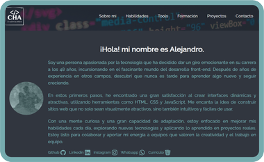

# Portafolio personal — Alejandro Casulli

<p align="center">
  <a href="https://ale-pogo.github.io/Mi_portafolio/">
    
  </a>
</p>

<p align="center">
  <strong>Portafolio profesional de desarrollo Front-End</strong><br>
  HTML · CSS · JavaScript · Diseño responsivo · GitHub Pages
</p>

<p align="center">
  <a href="https://ale-pogo.github.io/Mi_portafolio/">Ver sitio web</a>
  · <a href="https://github.com/Ale-pogo/Mi_portafolio">Ver repositorio</a>
  · <a href="https://www.linkedin.com/in/alejandro-casulli-222872300/">LinkedIn</a>
</p>

## Sobre el proyecto

Este portafolio presenta mi trayectoria profesional, conocimientos técnicos, formación académica y proyectos desarrollados como desarrollador Front-End.

Fue construido con tecnologías web estándar, sin frameworks ni dependencias, para ofrecer una experiencia rápida, accesible, responsiva y fácilmente desplegable con GitHub Pages.

## Características principales

- Diseño moderno adaptable a móviles, tablets y escritorio.
- Navegación fija y menú lateral responsivo.
- Carrusel de proyectos con botones, indicadores, gestos táctiles y reproducción automática.
- Efectos de aparición y transición entre secciones.
- Barra visual que muestra el progreso durante el desplazamiento.
- Secciones organizadas para presentación, habilidades, herramientas, formación y contacto.
- Formulario integrado con Formspree.
- Enlaces directos a redes profesionales, WhatsApp y currículum.
- Compatibilidad con preferencias de movimiento reducido.

## Tecnologías utilizadas

| Tecnología | Uso |
|---|---|
| HTML5 | Estructura semántica del contenido |
| CSS3 | Diseño visual, animaciones y responsividad |
| JavaScript | Carrusel, navegación, progreso y efectos |
| Formspree | Procesamiento del formulario de contacto |
| Git | Control de versiones |
| GitHub Pages | Publicación y alojamiento del sitio |

## Secciones del portafolio

- **Presentación:** información personal, redes profesionales y currículum.
- **Sobre mí:** trayectoria, motivación, habilidades y objetivos.
- **Skills:** tecnologías de desarrollo utilizadas.
- **Tools:** aplicaciones empleadas en el flujo de trabajo.
- **Formación académica:** certificados y cursos realizados.
- **Proyectos:** trabajos destacados en un carrusel interactivo.
- **Contacto:** formulario conectado con Formspree.
- **Footer:** navegación rápida y redes sociales.

## Proyectos destacados

### Encriptador de texto
Aplicación para cifrar, descifrar y copiar mensajes mediante una interfaz simple y adaptable.

**Tecnologías:** HTML, CSS y JavaScript.

### Alura Geek
Catálogo interactivo con productos, formularios y consumo de API.

**Tecnologías:** HTML, CSS, JavaScript y MockAPI.

### Alura Flix / Alura Metal
Aplicación SPA para administrar contenido audiovisual.

**Tecnologías:** React, Vite y MockAPI.

### Mi portafolio
Sitio que reúne mi experiencia, formación y proyectos profesionales.

**Tecnologías:** HTML, CSS y JavaScript.

## Carrusel de proyectos

El carrusel permite:

- Avanzar o retroceder entre proyectos.
- Seleccionar una tarjeta mediante indicadores.
- Desplazarse mediante gestos táctiles.
- Pausar automáticamente al mantener el cursor sobre el carrusel.
- Navegar con las teclas de flecha.
- Respetar la preferencia de movimiento reducido del navegador.

## Estructura de archivos

```text
Mi_portafolio/
├── assets/          # Imágenes, iconos, certificados y recursos gráficos
├── index.html       # Estructura y contenido principal
├── style.css        # Estilos, animaciones y diseño responsivo
├── script.js        # Carrusel, menú y efectos interactivos
├── README.md        # Documentación del proyecto
└── 001.css          # Hoja de estilos adicional
```

## Uso local

No se requieren instalaciones ni gestores de paquetes. Para ejecutarlo localmente:

```bash
git clone https://github.com/Ale-pogo/Mi_portafolio.git
cd Mi_portafolio
python -m http.server 4173
```

Después, abre:

<http://localhost:4173/>

También puede abrirse el archivo `index.html` directamente, aunque se recomienda utilizar un servidor local para evitar restricciones de navegador relacionadas con recursos externos.

## Publicación con GitHub Pages

```bash
git add .
git commit -m "Actualizar el portafolio"
git push origin main
```

Luego, en GitHub:

1. Abre **Settings → Pages**.
2. Selecciona **Deploy from a branch**.
3. Elige la rama `main`.
4. Selecciona la carpeta `/ (root)`.
5. Guarda la configuración.

El sitio queda disponible en:

<https://ale-pogo.github.io/Mi_portafolio/>

## Formulario de contacto

El formulario utiliza Formspree y solicita nombre, correo electrónico y mensaje. Para cambiar el destino, reemplaza el atributo `action` del formulario en `index.html` por el endpoint correspondiente de Formspree.

## Compatibilidad

El sitio está diseñado para navegadores modernos:

- Google Chrome
- Microsoft Edge
- Mozilla Firefox
- Safari

## Mejoras futuras

- Actualizar capturas de los proyectos.
- Incorporar filtrado por tecnología o categoría.
- Agregar modo claro y oscuro.
- Optimizar imágenes y recursos.
- Añadir más pruebas visuales y de accesibilidad.
- Migrar una futura versión a React o Vite si el sitio continúa creciendo.

## Autor

**Alejandro Casulli**

Desarrollador Front-End en formación continua, con experiencia previa en soporte técnico, gestión de compras y resolución de problemas.

- GitHub: [Ale-pogo](https://github.com/Ale-pogo)
- LinkedIn: [Alejandro Casulli](https://www.linkedin.com/in/alejandro-casulli-222872300/)
- Portafolio: [Ver sitio](https://ale-pogo.github.io/Mi_portafolio/)

## Licencia

Este proyecto se presenta como portafolio personal y educativo. Las imágenes, certificados y datos personales pertenecen a su autor. Se recomienda solicitar autorización antes de reutilizarlos con fines comerciales.

